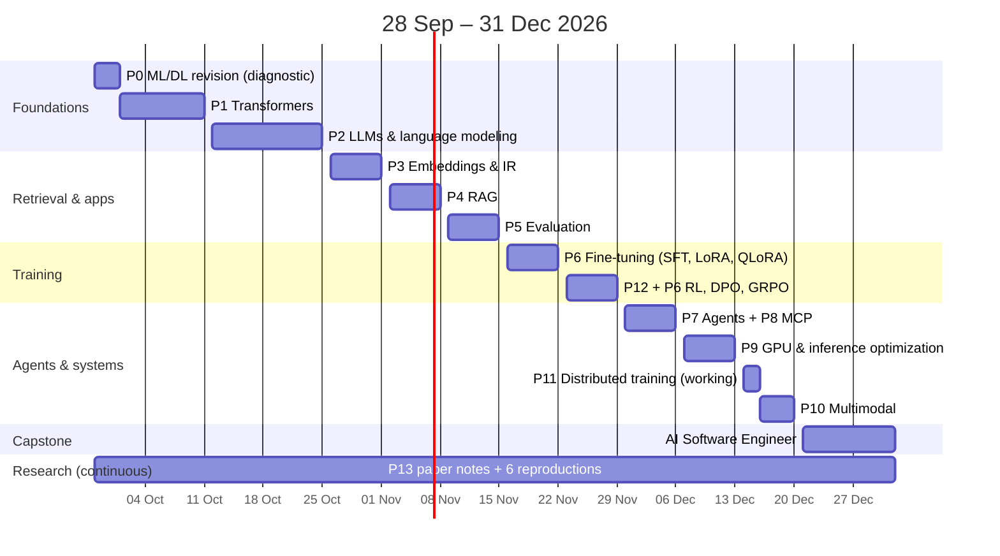

# 1. Executive roadmap

**Window:** Monday 28 September 2026 → Thursday 31 December 2026 = **13.5 weeks, 82 study days, ~290 hours** (3.5 h Mon–Fri, 4 h Saturday, Sunday off; 25 Dec is a buffer).

## The honest scope assessment

The curriculum you asked for — 13 phases, 11 projects and a capstone, at the depth of "implement it, measure it, read the papers" — is realistically **800–1,000 focused hours** for someone with your background. You have about **290 hours** before 31 December. That is roughly a third.

So this plan does **not** drop topics. It assigns every topic one of three depths:

| Depth | Meaning | Share of the 290 h |
|---|---|---|
| **MASTER** | Implement it yourself, explain it close-book, reproduce a result | ~65% |
| **WORKING** | Explain it correctly, use the standard library/tool, run one experiment | ~30% |
| **DEFER → 2027** | Named, scheduled in Q1–Q2 2027 with specific resources | (not in 2026 hours) |

The trade-off: you finish 2026 able to build, fine-tune, evaluate, serve and debug LLM systems from first principles, with a portfolio of 11 projects + a capstone and 6 small paper reproductions. You do **not** yet write production CUDA kernels, implement tensor/pipeline parallelism, run pretraining data pipelines at scale, or train VLMs from scratch — those are the Q1 2027 block (see [10-2027-continuation.md](10-2027-continuation.md)).

Three things make the sprint feasible:
1. **You skip what you know.** No backend, DevOps, cloud, Docker, databases, CI/CD or Python instruction; Phase 0 is 3 days, driven by a diagnostic.
2. **Projects compound into the capstone.** The retrieval engine (P4) becomes the capstone's code search, the eval harness (P6) grades everything after week 7, the research agent (P8) becomes the capstone's agent core, the MCP server (P9) is reused, the vLLM deployment (P10) is the capstone's cheap model tier. The capstone is an *integration* of parts you already built, not a greenfield project in two weeks.
3. **One primary resource per topic.** Stanford CS336 (Spring 2026) is the spine for language modelling, systems and post-training because its assignments come with test suites — but where a better explanation exists (Karpathy for building intuition in code, the Google DeepMind scaling book and Modal's GPU glossary for hardware, Hamel Husain and Anthropic for applied evals, Nathan Lambert's RLHF book for post-training), that is the primary instead.

## Phases → weeks

| # | Phase | Weeks | Hours | Depth | Key output |
|---|---|---|---|---|---|
| 0 | ML/DL revision | W1 Mon–Wed | ~10 | targeted revision | AdamW + manual backprop, diagnostic |
| 1 | Transformers | W1 Thu – W2, MoE in W4 | ~34 | MASTER (MoE: WORKING) | P1 attention, P2 transformer |
| 2 | LLMs & language modeling | W3–W4 | ~30 | MASTER | P3 tokenizer + small GPT + inference/sampling |
| 3 | Embeddings & IR | W5 | ~19 | MASTER | P4 retrieval engine |
| 4 | RAG | W6 | ~21 | MASTER core, WORKING graph/agentic | P5 advanced RAG |
| 5 | LLM evaluation | W7 | ~20 | MASTER | P6 eval framework |
| 6 | Fine-tuning & post-training | W8 + DPO in W9 | ~22 | MASTER (SFT, LoRA, QLoRA, DPO) | P7 fine-tuned model |
| 12 | RL for AI | W9 | ~15 | WORKING (PPO), MASTER-ish (GRPO loss) | GRPO run on verifiable math |
| 7 | AI agents | W10 | ~18 | MASTER loop/memory; WORKING frameworks, LangGraph hands-on | P8 research agent |
| 8 | MCP | W10 (+ capstone) | ~4 + capstone | MASTER | P9 MCP server |
| 9 | Inference & GPU | W11 | ~19 | MASTER reasoning, WORKING kernels | P10 vLLM serving report |
| 11 | Advanced training (distributed, data, scaling) | W12 Mon–Tue (+ scaling in W4) | ~9 | WORKING | memory/parallelism calculator |
| 10 | Multimodal | W12 Wed–Sat | ~15 | WORKING | P11 multimodal RAG |
| 13 | Research skills | every week | ~29 | MASTER | ~15 paper notes, 6 reproductions |
| — | Capstone | W13–W14 | ~27 | MASTER | AI Software Engineer v1 |

## What "done" looks like on 31 December

You can, without tutorials:
- implement attention, a Llama-style block, a BPE tokenizer, a training loop, KV-cache generation and the main samplers;
- explain every number in "prompt → next token" (FLOPs, bytes, KV memory, TTFT/TPOT);
- build a hybrid retrieval engine and a measured RAG system, and evaluate it with calibrated judges and confidence intervals;
- fine-tune an open model with SFT/LoRA/QLoRA, and run DPO and GRPO with your own loss implementations;
- build an agent without a framework, then with LangGraph, expose tools over MCP, and evaluate it;
- serve a model with vLLM and explain its performance with roofline math;
- read a new LLM paper in a day and reproduce its central claim at small scale.

## Where to go next

- [2. Prerequisite assessment](02-prerequisite-assessment.md) — what you skip
- [3. Month-by-month](03-month-by-month.md)
- [4. Week-by-week](04-week-by-week.md) — the day-level plan (also in the Excel tracker)
