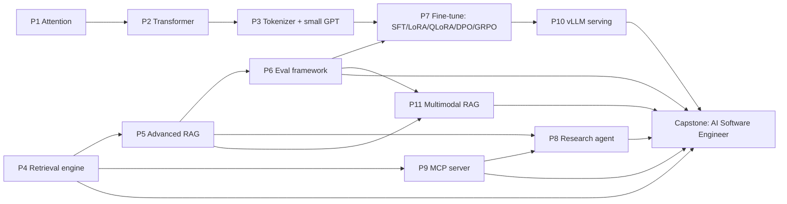

# 6. Project ladder

Eleven projects of increasing difficulty, each reused by later ones, ending in the capstone. Keep them all in one monorepo (`ai-2026/`) with a shared `pyproject.toml`, `pytest`, and a `README.md` per project containing: goal, design, how to run, results table, what broke, what you would do next.

| # | Project | Week | Difficulty | Skills developed | Reused by |
|---|---|---|---|---|---|
| P1 | Attention from scratch | W1 | ★☆☆☆☆ | Q/K/V shapes, masking, √d_k, testing numerical code | P2 |
| P2 | Transformer from scratch | W2 | ★★☆☆☆ | RMSNorm, SwiGLU, RoPE, GQA, encoder vs decoder | P3 |
| P3 | Tokenizer + small GPT (train, infer, scale, MoE) | W3–W4 | ★★★☆☆ | BPE, training loop, KV cache, sampling, scaling-law fitting | P7 (RL toy), P10 (spec decoding) |
| P4 | Embedding & retrieval engine | W5 | ★★★☆☆ | InfoNCE, BM25, IVF-PQ, HNSW, IR metrics, vector DBs | P5, P9, capstone code search |
| P5 | Advanced RAG | W6 | ★★★☆☆ | Chunking, query rewriting, hybrid + rerank, agentic RAG | P8, P11, capstone docs RAG |
| P6 | RAG / LLM evaluation framework | W7 | ★★★☆☆ | Error analysis, judges + calibration, faithfulness, statistics, CI gates | every later project |
| P7 | Fine-tune an open LLM | W8–W9 | ★★★★☆ | SFT + masking, LoRA/QLoRA, DPO, GRPO, verifiers | P10, capstone tool-calling model |
| P8 | AI research agent | W10 | ★★★★☆ | Agent loop, memory, planning, reflection, HITL, security, LangGraph | capstone agent core |
| P9 | MCP server | W10 | ★★★☆☆ | MCP primitives, transports, auth, tool design | P8, capstone |
| P10 | Optimize & serve with vLLM | W11 | ★★★★☆ | Roofline reasoning, batching, quantization, spec decoding, benchmarking | capstone cheap-model tier |
| P11 | Multimodal RAG | W12 | ★★★★☆ | ViT/CLIP, VLMs, document understanding, ColPali, Whisper | capstone screenshot input |
| CAP | AI Software Engineer | W13–W14 | ★★★★★ | Integration, evaluation, hardening | 2027 portfolio |

---

## P1 — Attention from scratch (W1)
- **Build:** `sdpa()`, causal/padding masks, `MultiHeadAttention` (fused QKV), cross-attention.
- **Tests:** equality with `F.scaled_dot_product_attention` and `nn.MultiheadAttention` (copied weights); no-future-leakage; fully-masked rows.
- **Experiments:** softmax entropy vs d_k with and without scaling; attention maps; memory vs T.
- **Done when:** tests green, notebook explains each plot in 2–3 sentences.
- **Stretch:** implement attention with `einsum` and with explicit loops; benchmark all three.

## P2 — Transformer from scratch (W2)
- **Build:** decoder-only GPT with RMSNorm, SwiGLU, RoPE, GQA (config toggles for LayerNorm/GELU/learned PE/MHA); encoder-decoder with cross-attention.
- **Tests:** RoPE relative-position property; parameter count vs formula; causal leakage.
- **Experiment:** encoder-decoder on sequence reversal/addition to >99% exact match.
- **Done when:** one config flag switches between "GPT-2 block" and "Llama block".
- **Stretch:** load real Llama/Qwen weights (small model) into your module and match Hugging Face logits.

## P3 — Tokenizer + small GPT (W3–W4)
- **Build:** byte-level BPE (passes CS336 A1 tests), training loop (own AdamW, cosine schedule, clipping, checkpointing), KV-cache generation, sampling suite, perplexity evaluator, MoE layer.
- **Experiments:** reproduction #1 (RoPE/NoPE/learned PE, pre/post-norm, LR sweep); reproduction #2 (mini IsoFLOP fit); dense vs MoE.
- **Done when:** a TinyStories model near the A1 target, generating coherent stories; KV cache speed-up plot; written "prompt → next token" explanation with numbers.
- **Stretch:** run [nanochat](https://github.com/karpathy/nanochat) end-to-end and compare its design choices with yours.

## P4 — Embedding & retrieval engine (W5)
- **Build:** one `Retriever` interface over BM25 (yours), Flat, IVF-PQ (yours, NumPy), HNSW (yours + FAISS), hybrid RRF, cross-encoder reranker, metadata filters, plus a pgvector or Qdrant backend; a small bi-encoder fine-tuned with your InfoNCE.
- **Benchmark:** BEIR SciFact + NFCorpus — nDCG@10, Recall@100, p50/p99 latency, memory per vector.
- **Done when:** your BM25 on SciFact is within ~0.02 nDCG@10 of the BEIR paper (reproduction #3) and the report explains every trade-off.

## P5 — Advanced RAG (W6)
- **Corpus:** something you care about and will reuse — recommended: the documentation + source of 2–3 open-source Python libraries you use (this becomes the capstone's docs RAG).
- **Build:** config-driven pipeline (Docling parsing, 4 chunkers, parent-child, contextual headers, query rewriting, multi-query, HyDE, hybrid + RRF, rerank, multi-vector path, context compression, agentic router), citations with spans, abstention, FastAPI streaming endpoint.
- **Done when:** a v0 ablation table exists and every stage can be toggled from config.

## P6 — Evaluation framework `ragevals` (W7)
- **Build:** versioned JSONL datasets; retrieval metrics; judges (binary rubric, pairwise with swap, reference-based) with a calibration report vs your own labels; faithfulness via claim verification; bootstrap CIs and paired tests; GitHub Actions gate; HTML/markdown report; agent task schema.
- **Done when:** P5's ablations are re-scored with CIs and one configuration is chosen on evidence; the CI gate fails a deliberately degraded config.

## P7 — Fine-tune an open LLM (W8–W9)
- **Task (recommended):** tool-calling for your own tools (the MCP tools from P9 and the capstone), returning schema-valid JSON — so the adapter is useful later and easy to verify.
- **Build:** SFT from scratch (masking, packing), LoRA from scratch, QLoRA of an 8B model, reward model, DPO from scratch, GRPO from scratch with verifiable rewards.
- **Experiments:** baseline vs LoRA ranks vs QLoRA; LR sweep (reproduction #4); DPO vs SFT win-rate; GRPO reward/length curves with and without Dr. GRPO normalization (reproduction #5); forgetting check.
- **Done when:** adapter on the HF Hub (private), report with baselines, and a list of observed reward hacks.

## P8 — AI research agent (W10)
- **Build:** framework-free reference loop (tools, stop conditions, retries, cost accounting, traces) → planning, reflection, memory (compaction + episodic/semantic), approval gates, sandboxed Python, prompt-injection tests → production version on **LangGraph** (StateGraph, checkpointer, `interrupt()`), with LangChain `create_agent` + middleware explored along the way.
- **Eval:** 20 research tasks — citation faithfulness (via P6), task success, steps, cost; pass^k on 5 tasks.
- **Done when:** the LangGraph version matches or beats the raw loop on the eval, and you can explain every framework abstraction in terms of your raw loop.

## P9 — MCP server (W10)
- **Build:** Python MCP server over the P4 engine: tools (`search`, `fetch_doc`), resources (`doc://{id}`), prompts (`cite_answer`); stdio + Streamable HTTP; authorization for the HTTP transport following the 2026-07-28 spec; tool descriptions written per Anthropic's tool-design guidance; tests incl. MCP Inspector session.
- **Done when:** your agent (P8) and at least one off-the-shelf MCP host can use it.

## P10 — Optimize & serve an LLM with vLLM (W11)
- **Build:** vLLM deployment of Qwen3-8B (and/or your merged P7 model) on a rented GPU; load-test harness (concurrency 1/8/32/128).
- **Matrix:** BF16 vs FP8 vs AWQ-INT4; prefix caching on/off (shared system prompt); speculative decoding on/off; max-num-seqs / chunked-prefill settings.
- **Report:** TTFT p50/p99, TPOT, throughput, goodput at an SLO, quality check with P6 — each result explained with roofline and KV-memory math (reproduction #6: continuous vs static batching).

## P11 — Multimodal RAG (W12)
- **Build:** ingestion of PDFs with charts/tables (Docling text + page images), ColPali/ColQwen page embeddings, audio via Whisper with timestamps; hybrid text + image retrieval; VLM answering over retrieved page images with page-number citations; voice query.
- **Eval:** 50 multimodal questions (chart reading, table lookup, scanned pages) — text-only vs image retrieval.

## Capstone — AI Software Engineer (W13–W14)
See [09-capstone-ai-software-engineer.md](09-capstone-ai-software-engineer.md).

## Compute budget (rough)

| Weeks | What | GPU | Hours |
|---|---|---|---|
| W3–W4 | TinyStories GPT, ablations, IsoFLOP runs | 1 × 24 GB (A10/L4/4090) or better | 10–15 |
| W8 | QLoRA 8B, LoRA sweeps on 0.6B | 1 × 24–48 GB | 8–12 |
| W9 | DPO, GRPO on 0.6–1.5B | 1 × 80 GB (A100/H100) | 4–8 |
| W11 | vLLM benchmarks | 1 × 80 GB (H100 preferred for FP8) | 4–6 |
| W12 | CLIP/nanoVLM/ColPali | 1 × 24 GB | 3–5 |
| W13–W14 | Capstone small-model tier + evals | 1 × 24–80 GB | 6–10 |

Total roughly 35–55 GPU-hours. Everything else runs on a laptop or free notebook GPU.
