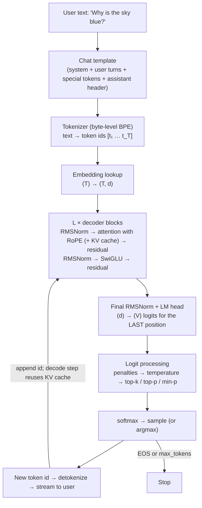

# Concept note 2 — From "user enters a prompt" to "the LLM emits the next token"

Used in weeks 3–4 (and again in week 11). Worked numbers use a Llama-3-8B-class model (32 layers, d_model 4096, 32 query heads, 8 KV heads, head dim 128, SwiGLU d_ff 14336, vocab 128,256, ~8.0B params) on one H100 SXM (≈989 dense BF16 TFLOP/s, ≈3.35 TB/s HBM). Treat all hardware numbers as round figures.

---

## 1. The whole pipeline



Two phases:

| | Prefill | Decode |
|---|---|---|
| Input | all T prompt tokens at once | 1 new token per step |
| Work | builds K/V for every prompt position | reads all weights + whole KV cache, appends 1 K/V row per layer |
| Bottleneck | **compute** (big matmuls, high arithmetic intensity) | **memory bandwidth** (~1 FLOP per byte at batch 1) |
| User-visible metric | **TTFT** (time to first token) | **TPOT / ITL** (time per output token) |

## 2. Step by step

### 2.1 Chat template → tokens
The API/UI never feeds raw text to the model. A Jinja **chat template** wraps each turn in special tokens (e.g. `<|start_header_id|>user<|end_header_id|> … <|eot_id|>`) and ends with the assistant header so the model's next token starts the answer (`add_generation_prompt=True`). A wrong template is one of the most common causes of a fine-tuned model "going weird" (week 8).

The tokenizer then applies regex pre-tokenization and BPE merges and returns ids. English averages roughly 3–4 characters per token; code and non-English text use more tokens per character.

### 2.2 Embedding
`E ∈ ℝ^{V×d}`: ids `(T,)` → vectors `(T, 4096)`. For this model E alone is 128,256 × 4,096 ≈ 525M parameters. No position is added here — RoPE injects position inside attention.

### 2.3 Decoder blocks (×32)
Each block: `x ← x + Attn(RMSNorm(x))`, then `x ← x + FFN(RMSNorm(x))` (see concept note 1). Inside attention, K and V for each position are **written to the KV cache** so later tokens never recompute them.

### 2.4 LM head → logits
Only the **last position's** hidden state matters for generating the next token: `logits = W_out · RMSNorm(h_T)`, a vector of 128,256 unnormalized scores. `softmax(logits)` is the model's next-token distribution.

### 2.5 Turning logits into one token (week 4)

```
logits ─► repetition / frequency penalties
       ─► ÷ temperature τ            (τ<1 sharpens, τ>1 flattens, τ→0 = greedy)
       ─► top-k: keep k largest
       ─► top-p (nucleus): keep smallest set whose cumulative prob ≥ p
       ─► min-p: drop tokens with prob < min_p × max_prob
       ─► softmax ─► sample
```

- **Greedy:** argmax. Deterministic, prone to loops.
- **Beam search:** keep the B best partial sequences by cumulative log-prob (with length normalization). Good for short, "one right answer" outputs (translation, ASR); bland and repetitive for open-ended text — the Holtzman et al. paper explains why.
- Order matters: temperature before top-p changes which tokens survive the nucleus.

### 2.6 Append and repeat
The sampled id is appended; the next step feeds **only that one token** through the network, reading the cached K/V for all earlier positions. This loop continues until EOS, a stop sequence, or `max_tokens`.

## 3. The numbers

### 3.1 FLOPs
Forward pass ≈ **2N FLOPs per token** (one multiply-add per parameter), plus attention's `≈ 4 · L · T · d` for the score/mix matmuls (small until T gets long). Training ≈ **6N FLOPs per token** (forward + 2× for backward).

- Prefill of a 1,000-token prompt: `2 × 8×10⁹ × 1000 ≈ 1.6×10¹³` FLOPs. At a realistic ~50% of 989 TFLOP/s → **~30 ms** of compute → TTFT in the tens of milliseconds plus scheduling overhead.

### 3.2 Bytes — why decode is memory-bound
Every decode step must stream all weights from HBM: `8×10⁹ params × 2 bytes ≈ 16 GB`.

- Lower bound per token at batch 1: `16 GB ÷ 3.35 TB/s ≈ 4.8 ms` → **at most ~200 tokens/s**, no matter how many FLOPs the GPU has.
- Arithmetic intensity at batch 1 ≈ `2N FLOPs / 2N bytes = 1 FLOP/byte`, while the H100 needs ≈ `989 / 3.35 ≈ 295 FLOP/byte` to be compute-bound. You are using well under 1% of the tensor cores.
- **Batching** is the fix: B sequences share one read of the weights, so intensity ≈ B FLOP/byte (until KV-cache reads dominate). That is why serving engines work so hard to batch (continuous batching, week 11).

### 3.3 KV-cache memory

```
KV bytes per token = 2 (K and V) × L × n_kv_heads × d_head × bytes
                   = 2 × 32 × 8 × 128 × 2  = 131,072 bytes = 128 KiB
```

- 8K-token context, one sequence: `8192 × 128 KiB = 1 GiB`
- batch of 16 such sequences: **16 GiB** — as large as the weights.
- Same model with full MHA (32 KV heads): 512 KiB/token → 64 GiB. This is why GQA, MQA, MLA and KV quantization exist.

### 3.4 Context windows
The context window is the maximum number of positions the model was trained (or extended) to handle. Longer context costs **O(T²)** attention compute in prefill and **O(T)** KV memory and bandwidth per decode step, and quality degrades beyond the trained length unless RoPE is rescaled (e.g. YaRN) and the model is trained on long data. "Lost in the middle" (week 6) shows that even within the window, information placement matters.

## 4. Training view: the same network, a different loop

- **Next-token prediction:** for a sequence `x₁…x_T`, predict `x_{t+1}` from `x_{≤t}` at every position in parallel (the causal mask makes this legal).
- **Loss:** mean cross-entropy `L = −(1/T) Σ_t log p_θ(x_{t+1} | x_{≤t})` = negative log-likelihood per token (in nats).
- **Teacher forcing:** during training the model always conditions on the *true* prefix, never on its own samples. At inference it conditions on its own outputs — the train/test mismatch called **exposure bias**.
- **Perplexity** = `exp(L)`: the effective number of equally likely choices per token. Loss 2.0 → PPL ≈ 7.4.
- **Bits per byte** = `(Σ NLL in nats / ln 2) / (number of UTF-8 bytes)`: tokenizer-independent, so you can compare models with different vocabularies.
- **Loss masking:** in SFT (week 8) only assistant tokens contribute to L (labels `-100` elsewhere).

## 5. Checkpoint questions (close-book)

1. Trace the shapes from `"Why is the sky blue?"` to a sampled id.
2. Why does the LM head only need the last position at inference but all positions in training?
3. Compute TTFT and max decode speed for a 70B model in BF16 on 4 × H100 with tensor parallelism (state your assumptions).
4. Compute KV-cache memory for your own week-3 model at its max context and batch 64.
5. Show, with a 5-token logits vector, how τ = 0.7 then top-p = 0.9 changes the candidate set.
