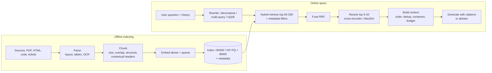

# Concept note 4 — RAG architecture and how to evaluate it

Used in weeks 6–7 (and for every later project: the P6 harness grades P8, P11 and the capstone).

---

## 1. RAG as a pipeline of replaceable stages

| Stage | Fixes | Can break |
|---|---|---|
| Structure-aware chunking | answers split across arbitrary boundaries | very uneven chunk sizes |
| Contextual chunk headers | chunks that are meaningless alone ("it increased 3%") | index cost (one LLM call per chunk) |
| Parent-child (small-to-big) | precise matching **and** enough context to answer | duplicate parents, token budget |
| Query rewriting | conversational follow-ups ("what about 2024?") | drift from the user's intent |
| Multi-query / decomposition | multi-hop and compound questions | latency, noise |
| HyDE | vocabulary mismatch between question and documents | hallucinated hypothetical doc pulls wrong neighbours on niche facts |
| Hybrid + RRF | identifiers and rare terms (BM25) + paraphrase (dense) | little, usually a free win |
| Reranking | good-but-not-best chunks crowding out the best one | latency (budget it) |
| Context compression | long, noisy chunks; lost-in-the-middle | dropping the sentence that mattered |
| Metadata filtering | wrong product/version/tenant | ANN recall under selective filters |
| Agentic retrieval | questions needing several dependent lookups | cost, loops (cap hops) |
| Graph RAG | "global" questions about a whole corpus | expensive index build, stale graph |

**RAG vs long context.** Long context removes retrieval errors but costs O(T) KV memory and bandwidth per generated token, is slower and more expensive per query, and still suffers position effects. RAG wins for large or frequently changing corpora and for citation/permission requirements; stuffing wins for small, stable, frequently re-queried documents (especially with prompt caching).

## 2. Evaluation — the professional workflow

1. **Look at data first.** Read 50–100 real traces. Write down what went wrong in free text (open coding), then group into a taxonomy (axial coding). Metrics come *after* you know your failure modes.
2. **Build a golden set** that mirrors those failure modes: real user questions, synthetic questions generated from the corpus *and verified by you*, unanswerable questions (the right answer is "I don't know"), adversarial ones (prompt injection in documents, near-duplicate versions).
3. **Separate retrieval metrics from generation metrics** so you know which stage to fix.
4. **Automate** with code checks where possible, LLM judges where necessary, humans to calibrate the judges.
5. **Gate changes** in CI with statistics, then **A/B test** online.

## 3. Metric definitions

### Retrieval (needs gold passages / chunk ids)
- **Recall@K**, **Precision@K**, **MRR**, **nDCG@K** — see concept note 3.
- **Context precision** (RAGAS-style): are the relevant chunks ranked near the top? A rank-weighted precision over the retrieved list.
- **Context recall**: fraction of the claims in the reference answer that are supported by the retrieved context.

### Generation
- **Faithfulness / groundedness:** fraction of claims in the answer that are supported by the retrieved context.
  1. Split the answer into atomic claims (LLM or rules).
  2. For each claim, ask a judge (or an NLI model) "is this entailed by the context?" → supported / not supported.
  3. `faithfulness = supported / total claims`.
  An answer can be **faithful but wrong** (the retrieved document was wrong) and **correct but unfaithful** (the model answered from memory) — you need both metrics.
- **Answer correctness:** agreement with a reference answer (exact match, token F1, or judge with the reference).
- **Answer relevance:** does it address the question asked (not just something true)?
- **Citation accuracy:** each cited source actually supports the sentence citing it.
- **Abstention quality:** precision/recall of "I don't know" on unanswerable items.

### Hallucination detection (beyond faithfulness)
Claim-level verification against sources (above); consistency checks across multiple samples (unstable facts are suspicious); and for closed-book models, verification against a trusted knowledge source.

## 4. LLM-as-a-judge done properly

- Prefer **binary pass/fail per criterion** with a written rubric over 1–10 scores; numeric scales drift and are poorly calibrated.
- **Pairwise** comparison is more reliable than absolute scoring for "is B better than A" — always run both orders (position bias) and count ties.
- Known biases: **position**, **verbosity** (longer looks better), **self-preference** (a model favours its own outputs), sensitivity to formatting.
- **Calibrate:** label 50–100 examples yourself, measure agreement with the judge (Cohen's κ, or TPR/TNR on "fail"), iterate on the rubric until acceptable, and re-check when the rubric or model changes (criteria drift — "Who Validates the Validators?").
- Use a judge model at least as capable as the system judged for hard criteria; use cheap models or code for easy ones.

## 5. Statistics you actually need

- **Bootstrap CI** for a metric: resample the eval set with replacement 1,000–10,000 times, recompute the metric, take the 2.5th/97.5th percentiles.
- **Paired comparison** (system A vs B on the same items): bootstrap the *per-item difference*, or use McNemar's test for pass/fail. Pairing removes item-difficulty variance and needs far fewer examples.
- Rough size intuition: with ~100 pass/fail items the 95% CI on a ~70% pass rate is about ±9 points — do not celebrate a 2-point gain on 100 examples.
- **A/B tests online:** randomize by user or session (not request) when outcomes carry over; pre-register the primary metric and guardrails (latency, cost, complaint rate); watch novelty effects; run to the planned sample size.
- **Regression testing:** a fixed golden set + thresholds on the paired difference in CI; failing items are saved as new tests (a failure seen once becomes a test forever).

## 6. Agents and tools (weeks 7 and 10)

- **Outcome > trajectory:** grade the final state (tests pass, DB row exists, file changed correctly) whenever possible; grade trajectories only for things outcomes cannot see (unsafe actions, wasted steps, cost).
- **Tool-call metrics:** tool-selection accuracy, argument exact match / AST match, invalid-call rate, recovery after tool errors.
- **Reliability:** τ-bench's **pass^k** — probability that *all* k independent runs succeed — exposes agents that are right on average but inconsistent.
- Track **cost, latency and number of steps** alongside success.

## 7. Checkpoint questions

1. Give an example answer that is faithful but incorrect, and one that is correct but unfaithful.
2. Your judge agrees with you 85% of the time but only catches 40% of your "fail" labels. Is it usable? What do you change?
3. System B beats A by 3 points on 150 items. What exactly do you compute before shipping?
4. Design the golden set for a support bot whose docs change weekly.
