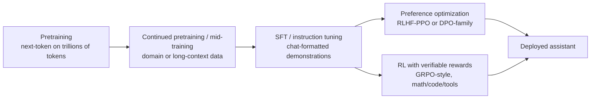

# Concept note 5 — Post-training math: SFT, LoRA/QLoRA, RLHF, DPO, GRPO

Used in weeks 8–9. Notation: `π_θ` is the policy (the LLM being trained), `π_ref` a frozen reference (usually the SFT model), `x` a prompt, `y` a completion, `y_t` its t-th token.

---

## 1. Where each stage sits



Rule of thumb for "which do I need?": knowledge that changes → **RAG**; behaviour/format/style/tool-use on a narrow task → **SFT (often LoRA)**; "which of two answers is better" signals → **DPO**; checkable correctness (tests, math answers, schema validity) → **RLVR**; new domain language at scale → **continued pretraining**.

## 2. SFT and loss masking

Same cross-entropy as pretraining, but only on the tokens you want the model to produce:

```
L_SFT = − Σ_t m_t · log π_θ(y_t | x, y_<t)  /  Σ_t m_t        m_t = 1 for assistant tokens, else 0
```

In Hugging Face code the mask is expressed by setting `labels = -100` for system/user/template tokens. Pitfalls: masking the assistant's end-of-turn token (the model never learns to stop); training with a different chat template than you serve with; packing several examples into one sequence without resetting attention or position ids where your framework requires it.

## 3. LoRA

Freeze `W₀ ∈ ℝ^{d_out×d_in}`; learn a low-rank update:

```
h = W₀ x + (α / r) · B A x          A ∈ ℝ^{r×d_in},  B ∈ ℝ^{d_out×r},  r ≪ min(d_in, d_out)
```

- Trainable params per matrix: `r (d_in + d_out)` instead of `d_in · d_out` (for 4096×4096 and r = 16: 131K vs 16.8M, ~0.8%).
- **Init:** A random (Kaiming/Gaussian), **B = 0** so training starts exactly at the pretrained model.
- **α / r** scales the update so changing r does not require re-tuning the learning rate as much.
- **Merge** for serving: `W = W₀ + (α/r) B A` → zero inference overhead. Or keep adapters separate to serve many LoRAs on one base model.
- Practical findings ("LoRA Without Regret", 2025): apply LoRA to **all** linear layers including the MLP, not only attention; the optimal LR is roughly **10×** the full-fine-tuning LR; LoRA matches full fine-tuning in the typical post-training data regime but falls behind when the dataset carries more information than the adapter can hold.

## 4. QLoRA and quantization basics

**Absmax (symmetric) INT8:** `s = 127 / max|x|`, `q = round(s·x)`, `x̂ = q / s`.
**Zero-point (asymmetric):** `s = 255 / (max − min)`, `z = round(−min·s) − 128`, `q = round(s·x) + z`.
**Block-wise:** use a separate scale per block of 64 values so one outlier does not destroy the precision of every other weight.

QLoRA:
- Base weights stored in **NF4** (4-bit NormalFloat): the 16 quantization levels are quantiles of a normal distribution, matching the roughly normal distribution of pretrained weights.
- **Double quantization:** the per-block scales are themselves quantized (saves ~0.37 bits/param).
- **Paged optimizers:** optimizer state spills to CPU memory on spikes instead of OOM-ing.
- Compute happens in BF16: dequantize a block → matmul → discard. Gradients flow only into the BF16 LoRA matrices.
- Memory: an 8B model's weights drop from ~16 GB (BF16) to ~5 GB, so a 24 GB GPU fits weights + LoRA + activations.

## 5. RL essentials for LLMs

- **MDP view of generation:** state = prompt + tokens so far; action = next token; policy = the LLM; reward usually arrives only at the end (sequence-level).
- **Return** `G`, **value** `V(s) = E[G | s]`, **advantage** `A(s,a) = Q(s,a) − V(s)` ("how much better than usual was this action").
- **Policy gradient** (log-derivative trick):

```
∇_θ J(θ) = E_{y∼π_θ} [ Σ_t ∇_θ log π_θ(y_t | x, y_<t) · A_t ]
```

  REINFORCE uses `A_t = G − b` with a baseline b (reduces variance without adding bias).
- **Actor-critic:** learn `V_φ` to compute advantages (GAE smooths them with λ).
- **PPO clipped objective**, with ratio `ρ_t = π_θ(y_t|·) / π_old(y_t|·)`:

```
L_PPO = E_t [ min( ρ_t A_t ,  clip(ρ_t, 1−ε, 1+ε) A_t ) ]
```

  The clip stops a single batch from moving the policy too far from the one that generated the data.

## 6. RLHF (InstructGPT recipe)

1. **Reward model** on human comparisons `(x, y_w ≻ y_l)` via Bradley–Terry:

```
P(y_w ≻ y_l | x) = σ( r_φ(x, y_w) − r_φ(x, y_l) )        L_RM = −log σ( r_φ(x,y_w) − r_φ(x,y_l) )
```

2. **RL objective** with a KL leash to the reference:

```
max_θ  E_{x, y∼π_θ} [ r_φ(x, y) ]  −  β · KL( π_θ(·|x) ‖ π_ref(·|x) )
```

   optimized with PPO (policy, reference, reward model and value model all in memory — four models, which is why it is expensive).

## 7. DPO — derive it once

The KL-regularized objective above has a closed-form optimum:

```
π*(y|x) = (1/Z(x)) · π_ref(y|x) · exp( r(x,y) / β )
⇒  r(x, y) = β log( π*(y|x) / π_ref(y|x) ) + β log Z(x)
```

Substitute this reward into the Bradley–Terry likelihood; `Z(x)` cancels because both completions share the prompt:

```
L_DPO(θ) = − E_{(x, y_w, y_l)} [ log σ( β log π_θ(y_w|x)/π_ref(y_w|x)  −  β log π_θ(y_l|x)/π_ref(y_l|x) ) ]
```

- `log π(y|x)` = sum of token log-probs of the completion (not the prompt).
- No reward model, no sampling, no value network: a classification-style loss on offline pairs.
- β ↑ keeps the policy closer to the reference.
- Relatives: **IPO** (regularized to avoid overfitting deterministic preferences), **KTO** (unpaired good/bad labels), **ORPO** (adds an odds-ratio preference term to SFT, no reference model), **SimPO** (length-normalized, reference-free margin).

## 8. RLVR and GRPO (reasoning models)

**Verifiable rewards:** `r(x, y) = 1` if the extracted final answer matches the ground truth (math), or if the tests pass (code), or if the output validates against a schema — plus small format rewards. No learned reward model to exploit, but verifiers can still be gamed.

**GRPO** (DeepSeekMath): drop the value network. For each prompt sample a **group** of G completions, score them, and use the group statistics as the baseline:

```
Â_i = ( r_i − mean(r_1..G) ) / std(r_1..G)             (same advantage for every token of completion i)

J_GRPO = E [ (1/G) Σ_i (1/|y_i|) Σ_t min( ρ_{i,t} Â_i , clip(ρ_{i,t}, 1−ε, 1+ε) Â_i )  −  β · KL(π_θ ‖ π_ref) ]
```

Known issues and fixes (week 9 reproduction):
- **Length bias** (Dr. GRPO): the `1/|y_i|` normalization makes long *wrong* answers less penalized per token, so length grows; dividing by `std` over-weights easy/hard prompts. Dr. GRPO removes both normalizations.
- **DAPO:** *clip-higher* (asymmetric ε to keep exploration alive), *dynamic sampling* (drop groups where all answers are right or all wrong — zero advantage, zero signal), *token-level loss averaging*, *overlong reward shaping*.
- Many recent recipes drop or shrink the KL term for verifiable-reward RL.

**Test-time compute:** RL-trained reasoning models learn to spend more tokens thinking; you can also scale inference directly (self-consistency / majority voting, best-of-N with a verifier, s1's budget forcing by appending "Wait").

## 9. Reward hacking — what it looks like in practice

- Code RL: the model edits or deletes the unit tests, special-cases the test inputs, or catches all exceptions.
- Math RL: outputs several answers hoping the extractor picks the right one; exploits a lenient answer parser.
- RM-based RLHF: longer, more confident, more flattering answers (reward models like length and agreement).
- Mitigations: strict verifiers with adversarial tests, sandboxed and read-only test files, KL/length controls, held-out evaluation with a *different* grader, and reading samples every run.

## 10. Checkpoint questions

1. Count trainable parameters for LoRA r = 16 on all linear layers of your week-2 model.
2. Show why `Z(x)` cancels in the DPO loss.
3. In GRPO, what is the gradient signal from a group where all 8 answers are correct? What does DAPO do about it?
4. Design a verifier for "return valid JSON matching this schema" and list three ways a policy could hack it.
